# Changelog

What changed in ce-workflow and its hub (pi-control-hub), newest first. One version covers both.

## 0.2.8 — 2026-10-30

### Added
- A session that messages another one over intercom while that one waits for your answer is no longer left hanging: the message is stopped with the question and its options, and the sending session can wait (it gets told what you picked once you answer), drop it, or, only when you told it to control or fix that session, answer it itself. An answer from another session shows a notice on the page, and the asked session is told it came from that session, not from you.
- A session another session is driving tells it when it starts waiting for your answer. This used to be off unless a setting was switched on; now it is always on, and stops as soon as you type in that session yourself.

### Changed
- Agents can now choose how to take in a screenshot: through the vision model to read what it says, or into their own context to judge how it looks (layout, alignment, colours). The first read of an image still points to the vision model and explains both; reading the same image again loads the pixels.

### Fixed
- Screenshots read through the vision model (process_image) no longer come back as a narrow answer that hides the page: every answer now starts with a transcript of all visible text, table rows, form fields and buttons laid out like the screen, then answers the question. Before, a question that expected another page got only "this is not that page", without what was actually on it.

## 0.2.7 — 2026-10-30

### Fixed
- /plan3 finish on a plan that was never reviewed now always offers the review first. When no other Plan model is available, it offers a review by the current agent instead of skipping the question.
- Cancelling the /plan3 finish dialog changes nothing: the plan stays a draft, research mode stays on and the session is not compacted. The choice of how to start work is now asked before the plan is marked ready.

## 0.2.6 — 2026-10-30

### Changed
- Opening a file link now shows the file in the viewer beside the chat, on this PC and on a phone, instead of a plain-text tab or Notepad: markdown is rendered, pages and PDFs show in a frame. Escape or Back returns to the chat as it was. Images, archives, folders and documents such as Word, Excel or SketchUp files open as before; on this PC, right-click → Open in app opens any file in its own program.
- Sessions also update to a new ce-workflow version after a compaction in the middle of a long run: the run stops at the next turn, reloads, and carries on by itself.

## 0.2.5 — 2026-10-30

### Added
- screen_read target=window can resize the window before capturing it (window.size, Windows and macOS), so the agent can check an app's layout at a given size. A minimized window stays minimized. On macOS the first resize asks for Accessibility permission for Pi Screen Helper.

### Changed
- Session files no longer grow to hundreds of MB. When a session parks, and in the daily cleanup, everything from before its latest compaction that the model never reads again is trimmed: screenshots, long tool output (cut to 500 characters), encrypted thinking signatures, reply diagnostics and earlier compactions' copies of the system prompt. Thinking text and every compaction summary stay. A 235 MB session became 11 MB, so it resumes and opens faster.
- Opening a session with a long history for the first time since the hub started is faster: its log is read once instead of twice, and not at all for a running session (older chat loads when you scroll up).

## 0.2.4 — 2026-10-30

### Added
- screen_read target=window works on macOS: list windows and capture one (also covered, in the background or minimized) with region and maxEdge like on Windows. A small Pi Screen Helper app, built on first use and signed with your Apple Development certificate when there is one, does the capture, so macOS asks for Screen Recording permission once for it instead of for the node binary. The grant survives Node upgrades and covers only screenshots.

## 0.2.3 — 2026-10-29

### Fixed
- mobile_act: retries when the helper agent is slow to start right after a simulator boot, instead of failing the first calls.
- mobile_act: home-screen widget placeholders no longer flood a snapshot; runs of one repeated character collapse and labels stop at 80 characters.
- mobile_act: actions sent in parallel to one device now run one after another instead of failing with "only one gesture at a time".
- mobile_act: elements on other pages of a pager (such as other home-screen pages) are marked offscreen, and the swipe direction is described as the side whose content it reveals.

## 0.2.2 — 2026-10-29

### Fixed
- mobile_act: the first action on an iPhone or simulator without the mobilecli helper used to install the helper and then report "nothing matches", because the install closes the open app. It now waits for the install to finish and says to launch the app again.

## 0.2.1 — 2026-10-29

### Fixed
- The desktop app's attention key (Ctrl+Shift+A) now jumps to a hub with a question before any hub with a finished session, even when the finished one is newer.

## 0.2.0 — 2026-10-29

### Changed
- With two or more hubs in the desktop app, each hub's taskbar bar splits into up to 4 segments, one per session: e.g. 2 working, 1 finished and 1 question show 2 orange, 1 green and 1 red. Every state keeps at least one segment; spare ones go to questions first, then finished sessions.
- mobile_act and screen_read target "device" use mobilecli bundled with ce-workflow (macOS, Linux and Windows, x64 and arm64), so there is nothing to install and the tool always works.

## 0.1.100 — 2026-10-29

### Added
- `browser_search`: Google web search in your own browser profile, as a compact numbered list with real URLs, sites, dates and snippets. If Google shows a CAPTCHA or the browser is closed, the agent falls back to `web_search`.
- `image_search`: Google Images in your browser. It returns one numbered contact sheet of thumbnails plus a list; the agent then saves only the originals it picks.

### Changed
- browser_act works in a background tab again, so it no longer takes over your screen; click the blue "Pi" tab group to watch. Reload the add-on (1.4) in `chrome://extensions`.

### Fixed
- The hub showed a parked session that still has timers as finished (green); it now shows as scheduled (blue).

## 0.1.99 — 2026-10-29

### Added
- mobile_act: the agent can read and drive an iOS Simulator, a real iPhone or an Android device through mobilecli. It reads the screen as labelled buttons and fields with positions, taps, long presses, types, swipes and presses hardware buttons, and every action returns what changed on screen. It can find and tap by label or id in one call, wait for text to appear or disappear, read on-screen text with OCR when the app hides it from accessibility (Mac), restart an app, and tap the visible part of overlapping cards. Long flows such as a whole game can run as a codemode script with no model turn per step. If mobilecli is missing, it asks before installing it.
- screen_read target "device" captures any iOS Simulator, iPhone or Android screen through mobilecli.

## 0.1.98 — 2026-10-28

### Changed
- The browser_act upload confirmation shows a thumbnail of each image in the hub, wraps long page addresses instead of cutting them, and offers "Allow .png from <folder> on <site> for 10 or 20 minutes" so repeated uploads from one folder stop asking.

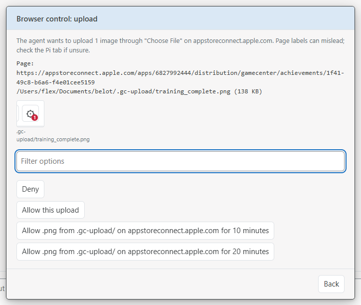

## 0.1.97 — 2026-10-28

### Added
- browser_act can upload images: only PNG, JPEG, GIF or WebP files inside the project folder (checked by content, max 10 of 20 MB), and Pi shows you each file, the site and the upload field and asks before every upload (browser extension 1.3: reload it in chrome://extensions).

## 0.1.96 — 2026-10-28

### Changed
- browser_act opens its tab in front so you watch every click and what it types (browser extension 1.2: reload it in chrome://extensions).
- When the browser cuts off browser_act, the message now says the browser's reason.

## 0.1.95 — 2026-10-28

### Fixed
- The browser helper keeps working after a node upgrade: Pi points it at the current node every time it starts, instead of only at Install.

## 0.1.94 — 2026-10-28

### Fixed
- Browser access → Install now registers the browser helper on macOS and Linux (Helium, Chrome, Chromium, Edge, Brave), so browser_fetch and browser_act work there.

## 0.1.93 — 2026-10-28

### Added
- Hub gear menu → Pi and extensions shows the browser extension's version with a Copy path button, to compare with chrome://extensions and Load unpacked or reload it.
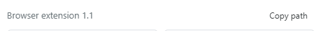

### Fixed
- Rebuild app now records the checkout's version, so the desktop app row shows it instead of the old one and the hub no longer downloads a release over the local build.

## 0.1.92 — 2026-10-28

### Added
- /wo → Settings → Browser access shows the browser extension's version; choosing it copies the extension folder path, so you can compare it with chrome://extensions and Load unpacked or reload.

## 0.1.91 — 2026-10-28

### Added
- browser_act: the agent can operate a site in your own browser, logged in as you, after you allow that site for 10, 20 or 30 minutes. It reads the page as a list of buttons, links and fields with positions, clicks, types, picks from dropdowns, scrolls, goes back and takes screenshots, in its own background tab in a "Pi" tab group. It never types passwords or one-time codes, and asks you before buying, paying, sending, deleting or publishing. Revoke a site in /wo → Settings → Browser access → Controlled sites. Reload the browser extension after updating.
- Files and View page: Hide files gives the viewed page or file the whole panel; Show files brings the list back.

### Changed
- browser_fetch no longer opens common bank and payment sites (Bulgarian banks, PayPal, Revolut, Wise, Stripe dashboard, ePay, EasyPay); they joined the built-in block list.

### Fixed
- A file path stayed plain text in chat when it had been mentioned before the file existed (an agent naming a render it was about to write); the hub now checks again.

## 0.1.90 — 2026-10-28

### Fixed
- ask_user options link file paths, folders and web addresses like the chat does, in the live form and in the answered question.
- Linux/macOS folder paths in chat (/home/you/project/lib) link and open like Windows ones; ~/ paths (~/notes/r.html) point to your home folder.
- Right-clicking a usage bar (Claude, Codex…) no longer hides it on the spot; it opens a menu with Open usage and Hide from the top bar.

## 0.1.89 — 2026-10-28

### Added
- View page: right-click (or, remotely, click) an HTML file linked in the chat and pick View page. It opens in the left pane with its folder's files beside it, from any device; Close, Back or Escape returns to the full chat. Images, data files and scripts next to the page load as they would from a local web server, including libraries from a CDN, so a 3D walkthrough runs without `py -m http.server`. Remotely, only files inside the session's project are served, and hidden files never are.
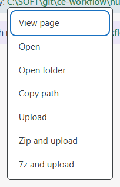

### Fixed
- Hub running in WSL: Windows file paths in chat (C:\Users\…) are clickable again, and Open, Download and Upload work on them; clicking opens the file through Windows Explorer.
- HTML pages inside an explored archive showed "This content is blocked" instead of the page.
- The CPU and memory hover popup no longer vanishes and comes back every few seconds; it now updates in place, top programs included.
- Pi Hub app: a hidden hub's state shows in the taskbar icon again; hiding only takes it off the tab strip.

## 0.1.88 — 2026-10-28

### Added
- Folder paths in chat (`C:\renders\p709`, `\\server\share\dir`, also in quotes with spaces) are links on the PC: click opens the folder; right-click offers Open, Copy path and Zip and upload.
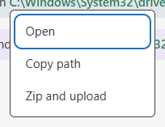
- Network share file paths (`\\server\share\file.pdf`) link like local files.

### Changed
- Phones: the message box slides away while you scroll back through the chat and returns at the end (or with ↓ New messages); it stays while you type.

### Fixed
- Claude usage no longer disappears from the usage bar after hours without using Claude; the account pool's reading shows even while the Claude login waits to be refreshed.
- Pi Hub app: a hidden hub you switch to no longer hides itself again a few seconds later while the app is still in front.

## 0.1.87 — 2026-10-27

### Added
- `browser_fetch`: the agent can read a page in your own browser (Helium, Chrome, Edge), so Cloudflare checks pass. You approve each site (once, 1/2/4 hours or always) with the full address shown; mail, sign-in and password sites and local addresses are never opened; a toolbar button pauses it; every fetch is logged; `images: true` saves the page images for the agent to look at. Set it up in `/wo` → Settings → Browser access.
- Ctrl+mouse wheel makes the hub page 10% bigger or smaller (50–200%), in the browser and the Pi Hub app; each hub remembers its size.

### Fixed
- Pi Hub app: Yes/No questions such as "Delete session" opened under the tab strip with their title hidden; they now open in the middle of the page.
- Switching sessions on a hub is faster, mostly from another PC or a phone: every session's page now shares one copy of the page scripts in the browser cache instead of downloading about 500 KB again for each session.
- After a background update, a page could load the new page files against the old hub still running and come up without its sidebar or diagram. The hub now reads its page files once at start, so page and hub always match; a page reloads by itself once the hub restarts onto new ones.
- Running the hub's tests could restart the Pi Hub desktop app onto a throwaway test hub ("127.0.0.1 refused to connect"); the test hubs now keep to a temporary profile.

## 0.1.86 — 2026-10-27

### Added
- Old session cleanup, once a day in the hub. Sessions untouched for 14 days lose their images, tool output past the first 500 characters and tool details, and stay resumable. Subagent forks go to the Recycle Bin at 14 days, other sessions at 30. Sessions in the hub sidebar are only trimmed, never deleted.
- Linux: hub settings show the sessions the cleanup moved to the Trash, with an Empty (N GB) button that deletes only those.
- Hovering the CPU or memory graph lists the 5 programs using the most of it.
- Updates no longer interrupt work. A session reloads onto a new ce-workflow by itself at its first quiet moment: when a run ends, between two plan steps (the plan then carries on), or after 2 idle minutes in the hub.
- The hub downloads extension updates as soon as it finds them, with sessions running. What needs a hub restart (the hub's own code, Pi itself) waits until no session is busy; the gear menu shows what is waiting and for whom. Update all with busy sessions now downloads instead of refusing.
- Pi Hub app: a tab's tooltip shows its hub's ce-workflow version, and a hub behind the newest one gets an orange ↑.

### Changed
- `/wo env` and the hub's env button set several variables at once: one `NAME=value` per line (a pasted `.env` works). The box starts with every name the last reply asked for, and nothing is set if any line is wrong.

### Fixed
- A very long session (a session file over 512 MB, mostly screenshots in tool output) opened with an empty chat. The hub now reads the file line by line and keeps only what the chat shows.
- Switching sessions no longer makes the sidebar vanish and come back: the new page draws the last session list right away and updates it when the hub answers.
- Desktop app settings: Update is always clickable and checks GitHub right away. It says when the build for this hub's version isn't published yet, and shows "up to date" when nothing is newer. Before, it stayed greyed out until the hub's own check (every 10 minutes) found the new build.

## 0.1.85 — 2026-10-26

### Added
- Desktop app: hide a hub from its tab's right-click menu. Hidden hubs leave the tab strip and the taskbar icon. Right-click an empty part of the strip to show them; Alt+number and the tray menu still open them. 10 seconds after the app loses focus they hide again, and the app switches back to the last hub that isn't hidden.
- Run a shell command from the chat box, like in Pi's terminal: `!git status` runs in the session's folder and shows the command and its output in the chat; the agent sees it on its next turn. `!!command` keeps the output from the agent. Works from a remote device too.

### Changed
- Desktop app: right-clicking a hub tab opens a normal menu at the mouse (Rename…, Reset name, Copy link, Reload, Remove) instead of a row of buttons across the tab strip.

### Fixed
- Pasting an image and pressing Enter right away now sends the text and the image together. Before, only the text went, and the image stayed in the box or went later as a steer. Send now waits while the pasted, dropped or attached file is still saving.

## 0.1.84 — 2026-10-26

### Added
- The Claude accounts window has Copy logins and Paste logins: copy the pool's logins (and its login-sync key) on one hub and paste them in another hub's window. Needs pi-provider-claude-ex with `cpool export`/`cpool import`.

## 0.1.83 — 2026-10-26

### Added
- The Files tab shows sizes in a right column: each file, and each folder's total (project files and explored archives).

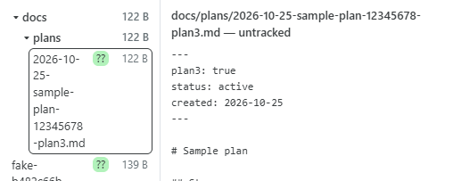

### Changed
- The hub checks for a new desktop app build every 10 minutes instead of hourly, so a release reaches the app soon after its build finishes.
- Desktop app on Windows has no title bar: the session sidebar runs to the top of the window, the hub tabs sit right of it, and the gear (with its update badge) plus minimize, maximize and close are at the top right of the tab line. Drag the empty tab line to move the window; double-click it to maximize.
- Closing an explored archive (Close, the browser's Back, or the mouse Back button in the desktop app) puts the chat back the way it was before Explore.
- On the dark taskbar tile the state bars are brighter, and waiting for a timer is light grey there; the timer blue elsewhere is a little brighter.

### Fixed
- A finished session counted as seen while the desktop app sat behind another program; now only the active window counts, and the session's own question/finished notification is no longer skipped then.
- The desktop app shows the hub's question and finished notifications (only the taskbar flashed before).

## 0.1.82 — 2026-10-26

### Added
- Explore an archive from chat: the file menu on a zip, 7z, rar or tar link unpacks it on the hub PC and the Files tab walks it (the chat shrinks to make room). Images open zoomable, markdown renders, HTML and PDF open in a frame, text shows as text, and every file has Download and Open. Works remotely too.

### Changed
- The full-size image viewer is centred on the image, the mouse wheel zooms at the pointer (the box grows to the screen, then scrolls), and dragging pans.
- Project command buttons can be this-PC-only (project_commands local): remote pages hide them, for runs that open windows or act on this desktop.
- hub/app/dev-restart.mjs (the Rebuild app button here) builds on every core: about a minute instead of several.
- A fourth session state: blue now means waiting for a timer (any pending timer, also when parked) and a finished, unseen session is green, in the tab icon, the desktop app icon and the sidebar. This replaces showing a timer due within 10 minutes as working.
- Desktop app taskbar icon with two or more hubs: a dark tile with one bar per hub (up to four), split into red, orange and blue for its states and dim when the hub is quiet, so it reads on light and dark taskbars.

## 0.1.81 — 2026-10-26

### Added
- New folder opens a proper dialog instead of the browser prompt, with a Local button that starts a session in ~/pi-local (made on first use) for machine requests like installing or checking something that belong to no project. The path box also accepts ~ for your home folder.
- Tab and app icon: a session whose timer fires within 10 minutes (e.g. a check loop) shows the working dot, so you can tell it is still on the job; the sidebar keeps showing it as scheduled.
- Desktop app: the "Update ready" note at the right of the tab strip is clickable and restarts the app on the new version, like the tray's Restart to update.
- Progress bar for long jobs: `pi-hub progress 2450 5000 items` (from the agent's bash, a background script or a timer script) shows a thin "items 2450/5000 (49%)" bar under the chat heading. It hides itself a minute after reaching the total or 15 minutes after the last report, so a forgotten one does not linger; `pi-hub progress --clear` removes it. Hub sessions and timer scripts now have `pi-hub` on PATH. The sidebar row shows it too, as a short percent and yellow bar above the session name, clear of the plan line below it.
- Desktop app has the ce-workflow version and follows it (#6): every pushed version gets its app built and published automatically, and after an update the hub downloads the matching app and restarts a running one onto it, with no extra step. Drafts and tabs are kept; hubs and sessions keep running.
- A red Update button appears top-right within about 10 minutes of a new ce-workflow version on GitHub (for git installs; Pi and other extensions are still checked hourly). It offers Update everything (Pi, extensions, ce-workflow) or Update only ce-workflow; the gear's update badges open the same choice.

### Changed
- Escape in an empty sidebar filter box puts the cursor back in the chat box instead of folding the session list away (with text in it, Escape still just clears it).
- The CPU and memory boxes in the top bar draw a faded filled graph instead of a thin line, with the number outlined in the box colour on top, so it stays readable.
- The schedule tool's help now says plainly that any output ends even a repeating timer, that timers survive a hub restart, that an ended timer's message can still arrive later as a follow-up, and that `pi-hub progress`/`notice` need PI_HUB_SESSION or --session.
- Desktop app taskbar icon: one hub shows its own icon; two or more show the dot grid (two hubs use the outer columns, the middle one stays empty) instead of two shrunken icons.
- Escape in the message box first clears what you typed (Ctrl+Z brings it back) or leaves a recalled prompt; only Escape in an empty box stops the run.
- ↑ on your last prompt while it is still running opens it in orange edit mode: Send stops the run and replaces the prompt instead of adding a second one.
- Devices moved out of the sidebar into Settings → Remote access, next to Copy.

### Fixed
- Script timers on Windows run in Git Bash, the same shell as the agent's bash tool, instead of cmd.exe, where `bash` started WSL.
- Check now for updates works with an npm-installed Pi; it failed with just "Node.js v24…". A failed check now shows the real error line.
- Pairing a phone or browser with one hub no longer unpairs it from another hub on the same Tailscale name (Windows and WSL hubs on one PC shared one cookie). Already paired devices keep working.

## 0.1.80 — 2026-10-25

### Added
- Typing into a parked session that needs compacting (cache expired, large context) starts the compaction right away, while you finish typing; your message waits for it and then goes out, instead of the compaction starting only after you press Send.
- Desktop app: the mouse back/forward buttons go back and forth through the sessions you visited, across every hub tab (answer a question with Ctrl+Shift+A, press back, and you are where you were); with Ctrl held they stay in the current hub.

### Fixed
- Tab and taskbar icon: a session asking a question shows red only; orange appears with it only when another session is working.

## 0.1.79 — 2026-10-25

### Changed
- Usage window: refill marks close together (e.g. 75% and 65%) put their labels on separate lines instead of printing over each other; the bar grows to fit.
- Settings → Remote access: Copy is a small button on the right of the address.
- The sidebar updates as soon as another session starts, finishes, asks a question or parks, even in a background tab, instead of on the next poll (up to 15 s, longer when the browser slows hidden tabs). A finish no longer seems to happen just when you click the session.
- The attention key (Ctrl+Shift+A in the app) opens a session asking a question before one that only finished.
- Sessions talking to each other over intercom no longer show as ready or send "finished" notifications when a run started only by the other session's message ends. A run you prompted still does.

## 0.1.78 — 2026-10-25

### Added
- Hub sidebar: drag a session row (mouse) to reorder the sessions inside its folder; the order is kept on the hub.
- Desktop app: an attention hotkey (default Ctrl+Shift+A, works from any app) brings Pi Hub to the front on the newest session that asks a question or finished; looking at it takes it off the list, so the next press goes to the one before. Change or turn it off under Attention key in hub settings (shown in the app).
- Hub model menu: right-click a model to set it as the work model (Plan3 coding) or add it to / remove it from the think models (Plan models, high effort), next to Set as default; one model can hold every role. The list marks them 👑 default, 🔨 work, 💭 think.
- Sessions: right-click → Copy intercom id copies e.g. `ce-workflow/1 (intercom 01a1543e)`, so another session can message it. In the chat, type @ and part of a folder/name (`@1`, `@lib`) to pick another session from a list (arrows, Enter/Tab) and write that reference.
- Model menu: the list still sets this chat's model; below it a Roles summary (👑 default, 🔨 work, 💭 think models) with each role's model and effort. A role row opens that role's list: pick the model (several think models), set its own effort on the picked row (work can keep the session's effort, or not switch model at all); ← or Escape goes back. Show all models lists the ones outside Pi's scoped set.
- Chat: a collapsed finished tool call is tinted by kind, file edits/writes slight red, reads slight green, the rest plain.
- Desktop app: the taskbar button flashes when something new needs you (a question, a finished run) while the window is not focused.
- Desktop app: with 3 or 4 hubs the taskbar icon is coloured dots only, one column per hub in tab order (rows: question, working, finished).

### Changed
- Phone: the usage window fills the screen; each account shows its e-mail on its own line and the 5h and 7d bars one under the other (nothing cut off on the right), and the picked account's buttons stay docked at the bottom in two neat rows.
- Sessions: every switch (sidebar click, group click, Alt+↑/↓, new session, a notification) opens the session with the chat box focused, ready to type; an open question keeps its own focus. Phones are exempt, so the keyboard does not pop up.
- Picking a session with the attention key, Alt+1…9 or the sidebar filter puts the cursor in the chat box, unless a question is open.

### Fixed
- Sidebar filter: Enter on a session clears the filter, so every folder shows again.
- The WSL hub can reuse Windows Tailscale for private remote access without installing a second Tailscale client.
- Desktop app (Windows): Alt+1…9 no longer stops working after switching tabs; the shortcuts are dropped only when another app is in front.

## 0.1.77 — 2026-10-24

### Fixed
- Asking several questions with a shared heading now opens the form instead of returning an error; the heading appears in the terminal, hub and answer summary.
- A live session no longer auto-parks while you are typing in its chat.

### Added
- Hub sidebar: a +/− box in front of each folder (or a click on its name) hides the sessions that are not working, or shows them all again. Sessions that have not worked for 2 days hide by themselves (Auto-collapse in hub settings: off, 12 hours to 1 week); shown again with +, they stay 5 minutes before hiding again.
- Hub sidebar: a filter box next to the ☰ button (Ctrl+Shift+F) finds sessions by folder or name; ↑/↓ move a dashed outline over the matches and Enter opens the picked one (the first match by default).
- Hub sidebar: right-click a folder name to open the folder on the PC or archive it; archived folders move to a closed Archives (n) section below, and right-click there unarchives them. Drag a folder by its name row to reorder the list; the order is kept on the hub.
- Hub model menu: Pi's default model (the one new sessions start on) has a 👑; right-click a model and pick Set as default model to change it.
- Hub sidebar: each folder name shows how many sessions it has, e.g. CE-WORKFLOW (3); the git line shows only in the open session's folder (and not while it is fully folded).

## 0.1.76 — 2026-10-24

### Added
- Windows: while a UAC admin prompt is open on the hub PC, every hub page (also on your phone) shows a notice, plus a desktop notification when question notifications are on. The prompt itself can only be answered at the PC.
- Hub settings has a Catch up button in sessions of the ce-workflow checkout itself; it runs `/wo catch-up`.

### Changed
- On phones and other touch screens, tapping a session's git counts no longer pops up the changed-files list over the session list.
- `/wo catch-up` shows its progress (each package's version change and diff download) in Pi and on the hub page instead of freezing Pi until the plan appears.

### Fixed
- `/new` on the hub page keeps the session's model and thinking level instead of switching back to the defaults.
- Desktop app on Linux: the tab strip no longer takes half the window (needs the next desktop app release).

## 0.1.75 — 2026-10-24

### Added
- Hub settings: a Remote access section on this PC's hub page turns Tailscale remote access on or off and copies the remote hub address for your other devices.
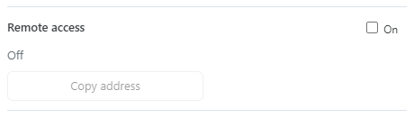

### Changed
- Hub settings: an extension's red × uninstall button shows only while the mouse is over its row (touch screens keep it).
- Hub settings: the bearded-face icon is gone from the tab icon picker, so the icons fill three full rows.

### Fixed
- Hub settings: a git extension whose installed copy already has GitHub's latest commit (or is ahead of it) no longer shows the ⟳ update mark.

## 0.1.74 — 2026-10-24

### Added
- Right-click a file link in the hub chat for Upload, Zip and upload, or 7z and upload (when 7z is installed). The hub encrypts the file, sends it to wormhole.app and copies the link, which works for 24 hours with no download limit. Only the key-holding link can open it. Files only, up to 5 GB; on Linux, Zip needs the zip package.
- When a plan is finished, the Plan ready menu offers "Start work in a new session". The agent first copies anything you asked for that the plan doesn't yet have into the plan's Decisions (devices, accounts, files to leave alone, push rules and so on), then the work starts in a fresh session with a small context. If you stop that step, you stay in the current session. The hub follows the switch: the chat shows the new session, and parking and resuming reopen it.

### Changed
- Camera tools are only offered to the agent when the project camera is turned on with a device chosen in Settings, saving about 4k characters on every request otherwise.
- The sidebar's changed-files list opens beside the sidebar, centred in the window, and grows to fit its files; it scrolls only when it reaches the chat heading.
- Settings is about 30% wider and can use the full window height.
- The plan's Review menu opens at the mouse instead of at the far right.

### Fixed
- A message sent from the hub no longer reappears in the message box when you switch tabs or sessions before the send finishes.
- Stopping the hub no longer hangs while a browser tab is still connected.
- Compaction in long sessions frees much more context. Only your last 20 messages are kept word for word; older ones are summarized into the decisions and rules that still apply. Answered questions keep only the question, your answer and the picked option. In two real long sessions the summary went from 245k and 145k characters to about 20k. Compactions that used to fail over a stray bracket or one bad citation now succeed. The recent part kept word for word after a compaction is now 20k tokens (Pi's default) instead of 30k.

## 0.1.73 — 2026-10-23

### Added
- Images in the chat box show as small thumbnails under it. Click one to annotate it: free draw, arrows, rectangles, circles, 6 colours, crop, and numbered markers (click, or press 1–9 over the image) with a note each. Ctrl+Z undoes, Del removes the selected element. Saving swaps in the annotated image and adds the notes as "(1) …" lines after it, so the model reads them exactly.
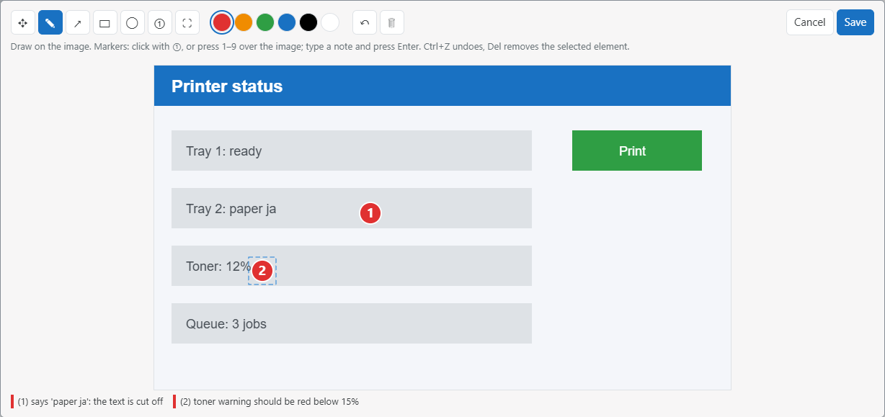
- Hub settings list your installed Pi extensions with their versions. A ⟳ in front marks one with an update waiting, and a red × uninstalls it (ce-workflow itself stays). Running sessions keep an uninstalled extension until they restart.
  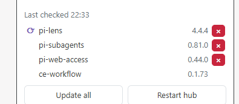

### Changed
- Desktop app: with 3 or 4 hubs, the taskbar icon is a grid of big dots, one row per hub in tab order and one column each for asking (red), working (orange) and finished (blue). The tiny hub pictures are gone, because they couldn't be read at taskbar size.
- When the chat sits next to the diagram, its header no longer shows Pull, Commit and Commit and push. They stay in the sidebar folder box, and in the header when the chat is expanded.
- On a phone, the File button is now 💾 and the chat box buttons are a little narrower, so Queue fits on the same row as Stop.

### Fixed
- A session that finished while you weren't looking stays blue after it auto-parks, with the 💤 beside it, until you open it.
- Desktop app: links in the chat that point outside the hub open in your default browser instead of doing nothing. The hub's own images and files still open inside the app.

## 0.1.72 — 2026-10-23

### Added
- In the chat box, ↑ at the start steps back through the messages you sent this session, and ↓ at the end steps forward again. If your last message was stopped, ↑ opens it in orange edit mode. Send then removes it and everything the agent did after it from the context, and sends your corrected version as a new message.
- Bookmarked messages: Ctrl+Shift+1…9 saves the chat box text as bookmark 1–9 for the session, Ctrl+1…9 puts it back. The new ★ button next to Stop lists them; click one to use it, or save the box text over a slot. Bookmarks stay in that browser.
- Hovering a folder's file counts in the sidebar lists the changed files, grouped as added, not in git yet, modified and deleted.
- Desktop app: right-clicking a tab opens Rename, Reset name and Remove. Names are kept per PC, and an empty name shows only the icon.

- Small blue ▲/▼ above the chat box step through your earlier messages. A recalled message turns the box light blue and shows when you sent it, in gold.
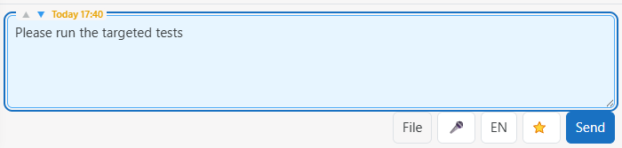

### Changed
- In the chat box, ↑ at the very top has to be pressed twice before it leaves your draft for older messages.
- The thinking-level button is renamed: Thinker (Plan), Thinker (Task), Default, Worker (Task), Worker (Plan), or Thinker / Default / Worker without a plan, in the hub and in Pi's status line. The model, context and thinking-level buttons get coloured icons (a chip, a bucket, crossed tools), and the chat view button gets the ? icon, which now stays visible when the button is switched on.
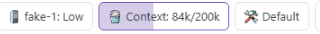
- Desktop app: Alt+1…9 switches tabs (Ctrl+1…9 now belongs to bookmarks).
- The model, context, thinking, research, night and env var buttons have small coloured icons.
- Modified files in the sidebar file line show as +n in red, like the other counts.

### Fixed
- Desktop app: dragging a tab to reorder works again.
- Claude refill marks (dotted lines on the 7d bar) no longer go missing for up to 30 minutes after a hub update.

## 0.1.71 — 2026-10-23

### Added
- Each folder in the sidebar shows its uncommitted files under its name: added +n (green), not in git yet +n (light green), modified ~n and deleted ×n (red). The open session's folder also has Pull, Commit and Commit and push as icon buttons on the right of that line.
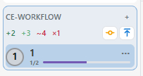
- A Pull latest button appears when origin has commits you don't have yet; the hub fetches in the background every 5 minutes. Pull latest, Commit and Commit and push each get a small icon (↓, ●, ↑).
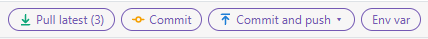

### Changed
- Desktop app 0.1.4: with two hubs, the status dots sit above and below the hub icons instead of on them (waiting and working below, finished above); with one hub the dots are a little bigger; with three or four hubs they are a little smaller.

### Fixed
- Desktop app 0.1.4: the big extra dot that covered the hub icons on the taskbar button now shows only when the app is pinned, where the icon itself can't change. There it carries the number of things waiting for you (questions and finished sessions you haven't opened).

## 0.1.70 — 2026-10-23

### Added
- Hub: the Claude 7d bar shows the next refills within 48 h as dotted lines at the level they bring. The usage window labels each line in grey with when it comes and the %, instead of the separate text lines and the → account line.
- Timers: a script timer can now check every 10 seconds, for example to wait for a program. Message timers still run at most once a minute.

### Changed
- Hub: in ⚙, Check now sits on the "Pi and extensions" heading, so the update list gets the full width.
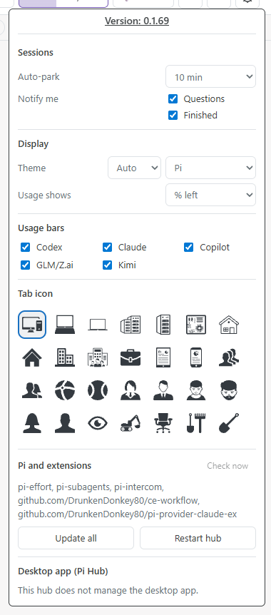
- Hub: ⚙ → Desktop app → Update works like the tray's Restart to update. It downloads the new build if needed and restarts a running app into it. The button no longer greys out once the build is downloaded.

### Fixed
- Desktop app 0.1.3: the taskbar button now shows your hubs' icons with their dots and follows icon changes. Since install added a Start Menu shortcut, Windows had drawn that shortcut's fixed PC icon instead.
- Desktop app 0.1.3: the window remembers whether it was maximized and opens that way next time.
- Hub (phone): a long plan name now ends in … and the step count (11/23) stays visible on the right.
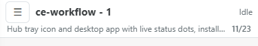
- Hub: a long ask_user option wraps next to its checkbox instead of dropping below it and leaving the box alone on a line.
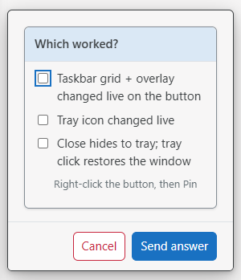
- Hub: a message you already sent no longer comes back in the box after the app or the browser closes abruptly.

## 0.1.69 — 2026-10-23

### Fixed
- Hub: Update no longer opens a pile of npm windows. It runs hidden, and if it fails, the hub opens its log so you see why.
- Desktop app: the pinned release is now 0.1.2, so ⚙ → Update brings the live taskbar icon.

## 0.1.68 — 2026-10-23

### Fixed
- Desktop app 0.1.2: an unpinned taskbar button now shows the live icon, your hubs' icons with their dots. Before, it showed the app's fixed PC icon. A pinned button still shows the fixed icon plus one live dot, because Windows doesn't let a pinned button change.

## 0.1.67 — 2026-10-23

### Added
- Hub: ⚙ → Desktop app (Pi Hub) has a Start button, which reads Stop while the app runs. Start at login now shares a row with Uninstall.
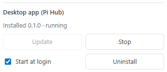

### Fixed
- Desktop app 0.1.1: adding, renaming and removing a tab now asks inside the tab strip. The old pop-up was cut off behind the hub page.

## 0.1.66 — 2026-10-23

### Fixed
- Hub: Install in ⚙ → Desktop app really works now; 0.1.65 shipped without the release pin.

## 0.1.65 — 2026-10-23

### Fixed
- Hub: Install in ⚙ → Desktop app works now; the first app release (0.1.0) is pinned.

## 0.1.64 — 2026-10-23

### Added
- Hub: a desktop app, Pi Hub, for Windows and Linux. Install it from ⚙ → Desktop app on this PC's hub page. It has one tab per hub (this PC, other PCs by their link). Its taskbar icon shows up to 4 hubs with their dots, and the tray shows the same dots even while the window is hidden. Updates arrive with ce-workflow updates; the tray offers Restart to update.
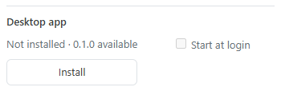
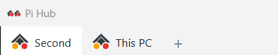
- Hub: Alt+= and Alt+- step the Think/Work bias, like in the terminal.
- Hub: the top bar shows a provider's 5h window next to its 7d one. Right-click a bar to hide it, or use the Top bar boxes in the provider's window. Hiding all of a provider's bars turns that provider off in the gear menu.
- Hub: in the Claude account window, Force use / Stop force marks one or more accounts to serve first (green in the terminal). Forced accounts get a green name and tint, and "Use" is now "Switch to".

### Changed
- Hub: a click outside the usage, devices, command and changelog windows closes them. Questions and approvals still stay open.
- Hub: in the Claude account window, each account's notes sit on its name line, so every row takes one line less.

### Fixed
- Hub: usage bars now show when Pi is installed with npm instead of Pi's own installer. GLM/Z.ai, Kimi and Copilot usage shows too (#5).
- Hub: a parked session keeps showing Research on when it was on.
- Hub: a session that finishes stays blue until you look at it, even when a page has it open in a background tab, a minimized app or on another device.

## 0.1.63 — 2026-10-22

### Changed
- Hub: an image path in a chat message shows its picture right under that line, not all together at the end of the message.
- Hub: the installed app's badge is now a number: how many sessions ask something or have finished work you haven't opened.

### Fixed
- Hub on Windows: the hourly update check no longer flashes console windows.
- Hub: tab and app icons are transparent again, with light ink on a dark tab bar (the iPhone home-screen icon keeps its white square).
- Hub on Linux/WSL: when the hub runs as a systemd service, Restart and Update from the gear (and pi-hub restart) work instead of killing themselves with the hub.

## 0.1.62 — 2026-10-22

### Added
- Hub: a run button's script can ask you things with no model turn. `pi-hub ask "Deploy where?" --option staging --option prod` shows the usual question form on the page (parked sessions too), waits for your answer and prints it; `pi-hub notice "Done"` shows a line on the page. Ask the agent to make such a button and it writes the script.
- Hub: a red ✕ on your last message removes it, and everything the agent did after it, from the context (a running agent stops first). Useful for a prompt sent by mistake.

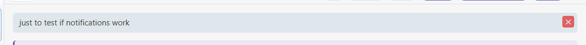
- Hub: an installed hub app (taskbar, dock, home screen) shows a badge while a session asks something or has finished work you haven't opened.

### Fixed
- Hub on Windows: run buttons' commands lost their output, even `> file` redirects.

## 0.1.61 — 2026-10-22

### Added
- `/wo env` and the hub's **Env var** button: store a secret as an environment variable, for this session only or permanently (Windows and Linux). The value never reaches the model; the agent only learns the variable's name. The name is suggested from the agent's last message.

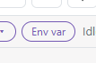
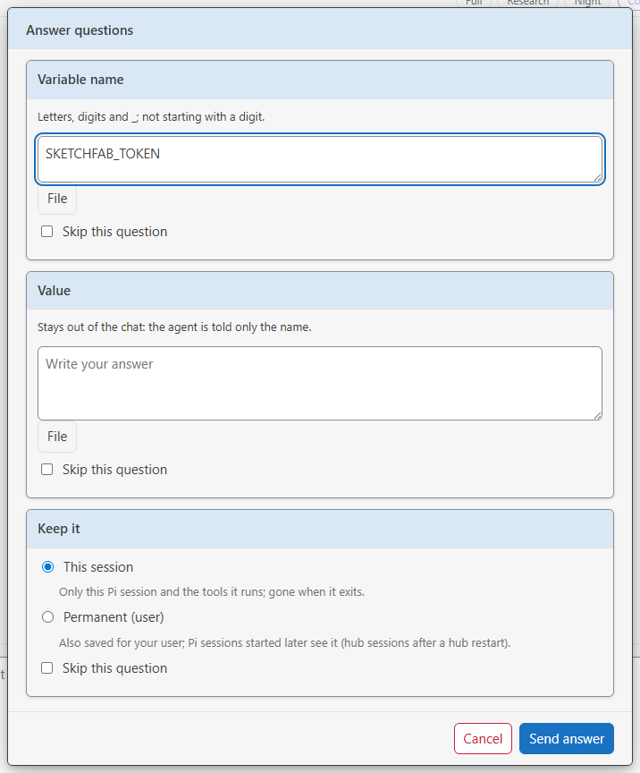

- Hub: file paths in the chat (any file the agent names, like `docs/plans/x.md`) are bold green links once the hub finds the file. On this PC a click opens it with its app, Shift+click copies the full path, Ctrl+click opens its folder, and right-click shows all three. From another device a click offers **Download**, **Open** (in a new tab) or **Copy path**, for images anywhere, and for other files in the session's project, or in temp and Downloads when changed in the last 5 days. Programs and scripts are only shown in their folder, never started.

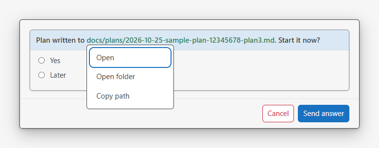

- Hub: **Commit and push** asks for scoped tests, the full suite or no tests.
- Hub: **Install** it as an app (Chrome, Edge, Brave, Android: the install icon in the address bar). It opens in its own window, named after this PC, with the tab icon you picked. On iPhone, use Share → **Add to Home Screen**; it gets the same icon.
- This changelog: the version at the top of the hub settings opens it, and after an update **What's new** opens once with only the newer versions.

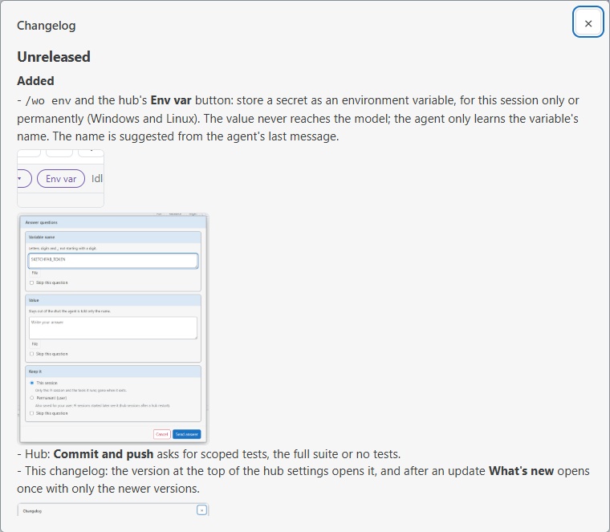

### Changed
- Hub settings gear: a red dot (no number) now means only that ce-workflow itself has an update. Pi and other extension updates show as a fainter yellow count in the lower-left corner.

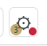

- Hub: in research mode the Context bar fills up to the model's real context window, since research doesn't compact at 200k.
- Hub tab icon shows one dot per kind of activity across sessions instead of only the most urgent one: red asks a question, orange working, blue finished and not yet looked at. Dots are smaller and fill the lower-right, lower-left, then upper-right corner.

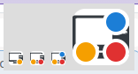

- Hub Thinking view keeps edit and write blocks visible, collapsed, so you can see what changed.

### Fixed
- Hub: the update count on the gear sits fully inside the button instead of being cut off.

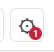

## 0.1.60 — 2026-10-22

### Added
- Hub: **Commit** and **Commit and push** buttons in the chat header, shown only when git has something to commit.
- Hub: project commands, per-folder buttons that send a prompt or run a command line; agents add them with the `project_commands` tool.
- Hub: hourly Pi and extension update check, with a count on the gear and **Check now**.
- Hub: **Ctrl+F** chat search with highlighted hits, a count and first/previous/next/last; also in the phone drawer.
- `/wo review`: a reviewer from the other provider checks the changes since your last commit or review. Settings can review after a plan or before a commit.
- Hub: red **Delete session** in the session menu (the session file stays in Recents).
- Hub: usage can show % left or % used.
- Hub: on this PC, files copied in Explorer are linked instead of uploaded again.
- Hub: four more tab icons.

### Changed
- Hub settings are grouped (Sessions, Display, Usage bars, Tab icon, Pi and extensions) with aligned controls.
- Hub tab icon shows the session state as a corner dot.
- Hub chat links quoted paths with spaces and `file:///` image or Markdown links.
- Plan3 shape check flags open questions without Option lines.

### Fixed
- Hub context button shows Pi's estimate after compaction instead of `?`.
- Hub survives starting at login: it retries Tailscale serve until it is ready and runs Pi's launcher by full path.

## 0.1.59 — 2026-10-21

### Added
- Hub scheduler: one-off or repeating timers that send a message or run a script, which only wakes the agent when needed. Sessions show a countdown, and timers can be cancelled.
- Hub polls subscription usage itself, so usage shows with every session parked. The gear chooses the providers.
- Hub remembers each session's model and thinking level; you can change them while it is parked.
- Typing in a parked session resumes it.
- Hub desktop notifications for questions and finished sessions (on by default).
- Hub tab icons: people, balls and an eye.

### Changed
- The terminal subscription footer is gone; the hub shows usage.
- Hub tab icon fills its square, coloured by state, with no shovel default.
- Claude accounts show 5h and 7d on one line.
- Sending a message shows Working at once.
- Plan3 think/work bias is remembered per session.

### Fixed
- Hub page switches to New plan when the current plan finishes by itself.
- Hub messages compact a cold cache before sending.

## 0.1.58 — 2026-10-21

### Changed
- Intercom wakes parked sessions by folder and waits until they join.
- Compaction on a cold cache happens automatically, without asking.

## 0.1.57 — 2026-10-20

### Added
- Intercom reaches parked hub sessions.

### Changed
- herdr support removed.

## 0.1.56 — 2026-10-20

### Changed
- Plan3 resolve shows submitted answers as a readable question/answer list.
- Hub usage window closes with a top-right ×.
- Clicking a folder group opens its last visited (or working) session.

## 0.1.55 — 2026-10-20

### Added
- Hub themes (Pi, Nord, Solarized) with Auto/Light/Dark per device.
- Hub: drop or paste any file into the chat; it is uploaded and its path inserted.
- Hub: queued messages can be edited or cancelled before they reach the agent; Stop returns them.
- Hub: `/new` from the page.
- Hub: auto-park after 10 minutes by default, set in the gear menu; the sidebar shows when a session parks.
- Hub: per-PC tab icon (14 icons).
- Hub: right-click or long-press a session for its menu, with Copy folder path.
- Hub: New folder offers to create a missing folder.
- Hub: thinking level per session without a plan.

### Changed
- Hub context shows progress toward compaction; the plan bar fills its row.
- ask_user questions show as a question/answer exchange in every chat view; links in question titles are clickable.
- Hub Claude pool window uses bars.

## 0.1.54 — 2026-10-20

### Added
- Hub: one usage bar per provider with warnings, and a usage window with 5h/7d bars and the Claude account pool.
- Hub: running tools show an elapsed timer.
- Hub on WSL2 opens links in the Windows browser, prints signed links and can start at login through systemd.

### Changed
- Catch-up with Pi 1.3.0, pi-subagents 0.79.1, pi-intercom 0.17.1 and pi-lens 4.4.4.

### Fixed
- Hub plan bar names the plan picked in the menu instead of New plan.
- Hub sidebar: clicking the plan progress line selects its session.

## 0.1.53 — 2026-10-19

### Added
- Hub running tools show an elapsed counter.

### Fixed
- Hub survives a reboot, and pairing works from saved session links.

## 0.1.52 — 2026-10-19

### Changed
- Hub desktop: full-width top bar (plan on the left; model, context, usage, think and gear on the right), short 7d usage text, tinted folder boxes and a plan progress line in the sidebar.
- Hub phone: two-line drawer status, orange top bar while working, plan name under the session name.

### Fixed
- Hub retries saving on Windows when antivirus briefly holds the file.

## 0.1.51 — 2026-10-19

### Fixed
- `/wo herdr import` now matches sessions; `/wo hub` offers the import when herdr is installed.

## 0.1.50 — 2026-10-19

### Added
- Approve a waiting device from `/wo hub`.

### Fixed
- An empty hub starts a first session instead of showing a JSON error.

## 0.1.49 — 2026-10-19

### Added
- `/wo herdr import` brings herdr's Pi sessions into the hub, named after their tabs.
- Hub gear: Update Pi and extensions.
- Hub plan menu: Force finish.
- Hub: CPU and memory graphs beside the gear.
- Hub: unsent chat drafts survive session switches and reloads.

### Changed
- Hub chat starts expanded when a session has no diagrams; context shows tokens (120k/1m).
- Hub Thinking view joins thinking into one block; the live tool line names its target.

### Fixed
- Camera no longer errors when a session starts in the home folder.

## 0.1.48 — 2026-10-19

### Added
- The hub now lives in this repo; `/wo hub` installs, starts, opens and restarts it.
- Hub chat views: Full, Thinking and Compact.
- Vision model setting: None, Current model or a chosen model.

### Changed
- A message sent while the agent works steers it instead of queueing.

### Fixed
- Compact chat view no longer collapses to the last reply.

## 0.1.47 — 2026-10-18

### Added
- pi-control-hub: one web front door that starts, parks and resumes Pi sessions and serves them to your phone.
- Every prompt goes through ask_user, so the terminal, the web and the hub draw the same form; short Yes/No prompts are one line.

### Changed
- `/wo share` and the per-session web workspace are replaced by the hub.
- Hub chat: compact mode and a highlighted final reply.

## 0.1.46 — 2026-10-16

### Added
- Web chat renders Markdown: bold, italics, code, headings, tables and links.

## 0.1.45 — 2026-10-16

### Added
- Web tab icon shows working, asking or idle.
- Web chat links http(s) addresses.

### Fixed
- An agent can leave research mode that Plan3 turned on.

## 0.1.44 — 2026-10-15

### Added
- Delete plan for unfinished plans.

### Changed
- Diagram boxes stay where you drop them on the open canvas.
- Dragging a connection highlights its target.

### Fixed
- `/wo share` finds Tailscale when it is not on PATH.

## 0.1.43 — 2026-10-15

### Added
- Push to talk in the web chat (English and Bulgarian).
- Images in answers: paste or pick images in web prompts; Alt+V in terminal ask_user.
- Web images: any image on this PC opens in an in-page viewer, including paths in tool output.

### Fixed
- Phone keyboard no longer pushes the page off screen.

## 0.1.42 — 2026-10-15

### Added
- Architecture workspace: plan and product diagrams with an editing bar (boxes, groups, connections, colours), live chat and comments.
- `/wo share`: open a session from your phone over Tailscale, with device pairing.
- Web chat: Pi-style light/dark colours, edit diffs, image thumbnails, / command completion, research/night chips and running subagents.

## 0.1.41 — 2026-10-13

### Added
- Vision: per-model effort and an optional second vision model.

## 0.1.40 — 2026-10-13

### Added
- Plan3 think/work bias on Alt+= / Alt+-.

## 0.1.39 — 2026-10-12

### Added
- `process_image` takes up to 10 images per question and fits them to provider limits.
- Tool-result images become references instead of filling the context.

## 0.1.38 — 2026-10-12

### Changed
- The legacy workflow orchestration is removed; Plan3 and the utilities remain.

## 0.1.37 — 2026-10-12

### Changed
- Plan3 turns uncertain assumptions into open questions that `/plan3 resolve` picks up.

## 0.1.36 — 2026-10-12

### Changed
- Plan3 resolve offers the recommendation as an answer when a question has no options.

## 0.1.35 — 2026-10-12

### Changed
- `process_image` falls back to the current model when no vision model is set.

## 0.1.34 — 2026-10-12

### Changed
- Plan3 resolve offers prose option lists as choices.

## 0.1.33 — 2026-10-12

### Changed
- Compact before the next request when tool work outlived the prompt cache.

## 0.1.32 — 2026-10-11

### Changed
- Reading an image file goes to `process_image` when a vision model is set.

## 0.1.31 — 2026-10-11

### Changed
- Plan3 finish offers a review before compacting; every question has a comment row.

## 0.1.30 — 2026-10-11

### Changed
- Advisors run on a model from another family.

## 0.1.29 — 2026-10-11

### Added
- `generate_image` and `process_image` tools.

## 0.1.28 — 2026-10-11

### Fixed
- Camera image cleanup skips quietly when another session holds the storage.

## 0.1.27 — 2026-10-11

### Added
- `screen_read` browser and Android targets on Linux and macOS, with an adb fallback.

## 0.1.26 — 2026-10-11

### Added
- Camera tools: stills, crops, bursts and change/settled watches, with per-use consent and a red warning.

## 0.1.25 — 2026-10-10

### Changed
- Plan3 tags phases by judgment and records per-step replies, failures and models.

## 0.1.24 — 2026-10-10

### Added
- Plan3 requirements (Alt+A): steps wait while what they need is off.

## 0.1.23 — 2026-10-10

### Added
- Plan3 run statistics and [human] steps.

## 0.1.22 — 2026-10-10

### Fixed
- Plan3 execution starts cleanly after tagging.

## 0.1.21 — 2026-10-10

### Changed
- Plan3 tagging runs on its own; the footer shows the weekly reset time.

## 0.1.20 — 2026-10-10

### Added
- Plan3 [think]/[code] phase tags.

## 0.1.19 — 2026-10-10

### Fixed
- Plan3 detects any step heading as a phase.

## 0.1.18 — 2026-10-10

### Added
- `/wo settings` shows the ce-workflow version.

## 0.1.17 — 2026-10-10

### Added
- Plan3 per-plan model overrides and a review offer before work.

## 0.1.16 — 2026-10-10

### Changed
- Enter runs slash-command argument completions; Plan3 model rows use the scoped model picker.

## 0.1.15 — 2026-10-10

### Added
- Plan3 planning and coding models per phase.

## 0.1.14 — 2026-10-10

### Added
- Night mode (Alt+N, `/night`): work on a plan unattended.
- Research mode on Alt+R.

## 0.1.13 — 2026-10-09

### Added
- `screen_read` tool.

## 0.1.12 — 2026-10-09

### Changed
- Plan3 never stops execution for context size.

## 0.1.11 — 2026-10-09

### Changed
- Plan3 flags no-commit rules and runs the full suite at phase boundaries.

## 0.1.10 — 2026-10-09

### Added
- Plan3 execution defaults and local commits.

## 0.1.9 — 2026-10-09

### Changed
- Plan3 design hand-off size limit covered by tests.

## 0.1.8 — 2026-10-09

### Added
- Plan3 shape check with one repair turn.

## 0.1.7 — 2026-10-09

### Changed
- Plan3 optimize uses a model-independent check.

## 0.1.6 — 2026-10-09

### Changed
- Plan3 requires a one-line summary when a step is marked done.

## 0.1.5 — 2026-10-09

### Added
- Plan3 design workflows.

## 0.1.4 — 2026-10-08

### Added
- `/wo` subcommands for Plan3 and utilities.

## 0.1.3 — 2026-10-08

### Added
- Plan3 conversion and the frontend design skill.

## 0.1.2 — 2026-10-07

### Fixed
- Plan3 resolve opens its popup directly.

## 0.1.1 — 2026-10-07

### Added
- Plan3 file viewer and batched resolve answers.
